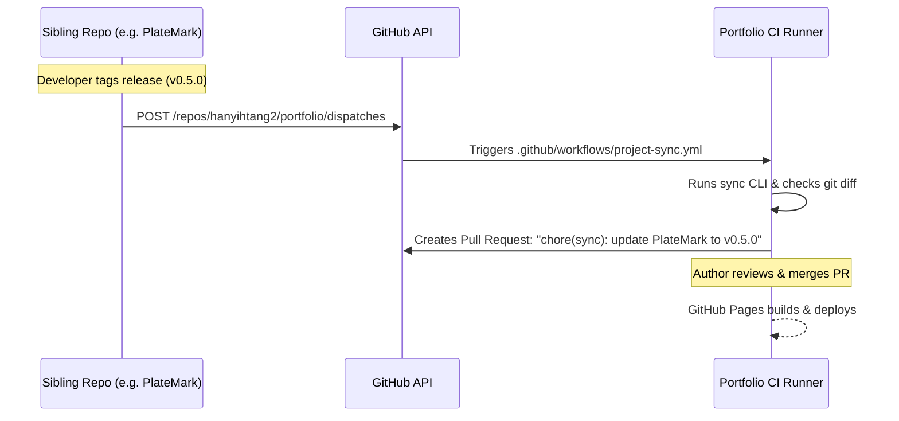

# PRD: GitHub Actions Event Bus and Automated Sync PRs (Phase 3 - Deferred)

> [!NOTE]
> **Status: Deferred / Skipped**
> This headless webhook / `repository_dispatch` pipeline has been deferred. Sibling repository metadata is standardized via `portfolio-meta.json` (Phase 2), and narrative + technical updates are driven interactively by the **AI Agentic Co-Pilot (Phase 4 / FEAT-004)**, which avoids cross-repository PAT token management while supporting rich case-study prose drafting.

## 1. Executive Summary & Problem Statement
Running local CLI scripts (`npm run sync:projects`) relies on the author remembering to run commands manually. To achieve hands-free portfolio maintenance, we need an automated event-driven pipeline: whenever a sibling repository cuts a release tag (e.g. `v0.5.0`) or merges a milestone PR to `main`, it notifies the portfolio repository via GitHub's `repository_dispatch` API.

The portfolio's CI pipeline catches the event, fetches the latest project metadata, and automatically creates a clean Pull Request (`chore(sync): update PlateMark to v0.5.0`) for one-click merge.

---

## 2. User Stories
- **As the developer**, I want to push a git release tag in PlateMark (`git tag v0.5.0 && git push --tags`) and have a Pull Request automatically appear in my portfolio repo with all roadmap and tech stack updates pre-computed.
- **As the portfolio maintainer**, I want to review the automated PR on my phone or laptop, verify the diff, and merge to immediately trigger GitHub Pages deployment.
- **As a security-conscious engineer**, I want cross-repository access tokens to have minimal scope, preventing unauthorized repository writes.

---

## 3. Scope & Key Capabilities

### In Scope
- **Sibling Dispatch Workflow Template**:
  - Reusable GitHub Action (`.github/workflows/notify-portfolio.yml`) triggered on `push: tags: ['v*.*.*']` or workflow dispatch.
  - Sends a payload containing `{ project: "platemark", tag: "v0.5.0", commit: "..." }`.
- **Portfolio Receiver Workflow**:
  - Workflow in `portfolio` (`.github/workflows/project-sync.yml`) listening to `repository_dispatch: types: [project-updated]`.
  - Runs headless synchronization script via GitHub API or checked-out release metadata.
- **Automated Pull Request Generation**:
  - Uses `peter-evans/create-pull-request` to generate a dedicated branch and PR with formatted release notes and roadmap diffs.
- **Security & Token Documentation**:
  - Runbook on configuring GitHub Fine-Grained Personal Access Tokens (PAT) restricted strictly to `repository_dispatch` and `contents: write`.

### Out of Scope
- Direct pushing to `main` without a Pull Request (PR review gate is mandatory to preserve human oversight).

---

## 4. Technical Architecture & Constraints

- **Runner Environment**: GitHub Actions Ubuntu Runner (`ubuntu-latest`, Node 24).
- **Execution Guard**: If no frontmatter differences exist, the workflow exits cleanly without creating an empty PR.

---

## 5. Acceptance Criteria
- [ ] Tagging a release in PlateMark triggers the portfolio receiver workflow.
- [ ] Portfolio receiver opens a valid PR with accurate commit messages.
- [ ] Astro static build passes in CI before PR is opened.
- [ ] Comprehensive documentation exists for configuring the secret token.

---

## 6. Task Breakdown Index
- [ ] `TASK-010`: Create sibling repository dispatch workflow template
- [ ] `TASK-011`: Build portfolio receiver workflow for `repository_dispatch`
- [ ] `TASK-012`: Configure automated Pull Request creation & change summary generator
- [ ] `TASK-013`: Document token security, PAT permissions, and repository secrets runbook

