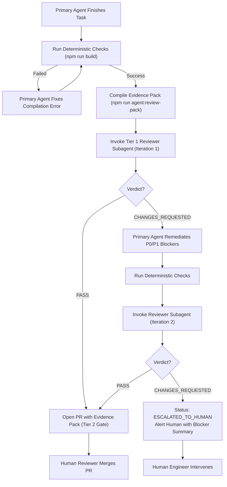

# Agent Review Contract & Severity Taxonomy Specification

**Version:** 1.0.0  
**Status:** Canonical  
**Applies to:** Portfolio & Sibling Repositories (PlateMark, MAKER, CommuteShift)  
**Governing Feature:** FEAT-005 Two-Tier Agentic Review and Quality Gate Pipeline  

---

## 1. Purpose & Principles

This contract establishes a deterministic, objective standard for automated AI code reviews. In an agentic software development workflow, code review by an independent agent must prevent **confirmation bias** and **hallucinated nitpicking** while enforcing uncompromising rigor on functionality, security, architectural boundaries, and acceptance criteria.

### Core Tenets

1. **Deterministic Priority:** An LLM review must **never** run on code that fails deterministic checks (compilation, type checks, linting, tests). Deterministic tools fail fast and cost zero tokens.
2. **Proof-of-Defect:** No finding may be reported without an exact code reference, a concrete failure scenario or violated criterion, and an actionable remediation snippet. Abstract commentary (e.g. *"consider improving modularity"*) is strictly forbidden.
3. **Bounded Iteration:** The review loop between the primary coding agent and reviewer subagent is capped at **maximum 2 iterations**. If blocking defects cannot be resolved in two passes, the task escalates to human review to prevent token exhaustion.
4. **Separation of Concerns:**
   - **Tier 1 (Inner Loop / Pre-PR):** Fresh-context subagent reviews the diff against local acceptance criteria and areas rules before PR creation.
   - **Tier 2 (Outer Loop / PR Gate):** Automated GitHub Actions CI workflow audits PR evidence pack and executes remote deterministic test matrix for human merge sign-off.

---

## 2. Severity Taxonomy

Every finding produced by a reviewer agent must be categorized into exactly one of three severity levels:

| Severity | Label | Merge Impact | Auto-Fix Loop Trigger | Description & Triggers |
| :--- | :--- | :--- | :--- | :--- |
| **`P0`** | **Blocker** | **BLOCKS** | **Yes (Mandatory)** | Deterministic failure, violated acceptance criteria, runtime crash, data corruption, or security vulnerability. |
| **`P1`** | **High** | **BLOCKS** | **Yes (Mandatory)** | Scope violation (`pm/areas.json`), missing critical error boundary, regression risk on edge cases, or broken API contract. |
| **`P2`** | **Nit / Suggestion** | **DOES NOT BLOCK** | **No (Optional)** | Non-blocking readability suggestions, style suggestions, or optional micro-optimizations. |

---

### Detailed Severity Definitions

#### P0: Blocker (Mandatory Fix Required)
A P0 finding represents an unconditional stop-ship defect. If any P0 finding exists, the review verdict is `CHANGES_REQUESTED`.

**Qualifying Conditions:**
- **Deterministic Check Failure:** TypeScript compilation errors, Astro build failures, or failing automated unit/integration tests.
- **Acceptance Criteria Failure:** Any explicitly checked or required criterion in the task or parent PRD that is not satisfied or is partially implemented.
- **Unhandled Runtime Exceptions:** Unhandled promise rejections, unchecked `null`/`undefined` property accesses in core paths, or unvalidated user inputs causing crashes.
- **Data Loss / State Corruption:** Inconsistent writes to database or file storage, race conditions causing state overwrites, or broken AST manipulation that corrupts markdown files.
- **Security Vulnerabilities:** Hardcoded API keys or secrets, path traversal vectors (`../`), cross-site scripting (XSS), SQL injection, or unescaped HTML injection.

#### P1: High (Mandatory Fix Required)
A P1 finding represents an architectural, boundary, or stability violation that degrades maintainability or introduces hidden regressions. If any P1 finding exists, the review verdict is `CHANGES_REQUESTED`.

**Qualifying Conditions:**
- **Boundary Violation:** Modifying files outside the task's declared `target_paths` or outside the area scopes defined in `pm/areas.json` without documented justification.
- **Missing Error Handling on I/O:** Unhandled network timeouts, missing fallback for missing files, or swallowed errors that hide systemic failures.
- **API Contract Breakage:** Modifying existing exported functions, interfaces, or CLI flags in a backwards-incompatible manner without deprecation or migration handling.
- **Unchecked Edge Cases:** Failing to handle empty arrays, empty strings, zero values, or maximum length payloads when processing dynamic external inputs.

#### P2: Nit / Suggestion (Informational Only)
A P2 finding is an observation or advisory note. P2 findings **never block a merge**, do not count towards the blocker tally, and do not trigger a review loop iteration.

**Qualifying Conditions:**
- Typo in a comment or internal docstring (not user-facing).
- Suggestion to use an alternative idiomatic pattern where the current code is already correct, tested, and readable.
- Informational note on future refactoring opportunities when extending the module.

---

## 3. Proof-of-Defect Requirement

To ensure findings are trustworthy and immediately actionable, reviewer subagents must supply concrete proof for every P0 and P1 finding:

```text
Finding Format Requirement:
1. File Path:      Exact relative repository path (e.g. `scripts/sync-projects.ts`)
2. Line Range:     Exact start and end line numbers in the proposed branch diff (e.g. lines 45-52)
3. Criterion / ID: Reference to the violated Acceptance Criterion or requirement ID
4. Failure Proof:  A realistic input or scenario triggering the bug (e.g. "When input is undefined, response.body.id throws TypeError")
5. Concrete Fix:   Exact code replacement or diff snippet that resolves the defect
```

### Finding Anti-Patterns (Forbidden Output)

❌ **Forbidden (Abstract Bikeshedding):**
> *"Consider extracting this logic into a helper function for better separation of concerns."*  
> *(Violates proof-of-defect; this is an ungrounded style preference.)*

❌ **Forbidden (Vague Speculation):**
> *"This might fail in production if the network is slow."*  
> *(Violates concrete failure proof; no specific missing timeout or error boundary is cited.)*

✅ **Valid (Proof-of-Defect Compliant):**
> **Severity:** P0  
> **File:** `scripts/agent/synthesize-commits.ts` (L78-L82)  
> **Criterion:** AC-3 ("Zero unhandled null references when git commit list is empty")  
> **Proof:** `gitLog.split('\n')[0].match(...)` throws `TypeError: Cannot read properties of undefined` when `gitLog` is empty string.  
> **Suggested Fix:** Add guard `if (!gitLog?.trim()) return [];` before line 78.

---

## 4. Review Verdict Contract & Machine-Readable Schema

Reviewer subagents must format their final review evaluation as structured JSON conforming to [`review-verdict.schema.json`](./schemas/review-verdict.schema.json).

### Verdict States

- **`PASS`**: `blocking_count === 0` (no P0 or P1 findings). P2 nits may be present. The branch is cleared for pull request creation and Tier 2 quality gates.
- **`CHANGES_REQUESTED`**: `blocking_count > 0` (at least one P0 or P1 finding). The primary agent must remediate all blockers and request a re-review (up to iteration 2).
- **`ESCALATED_TO_HUMAN`**: The review has reached the maximum iteration limit (2 passes) and blockers remain unresolved. Execution pauses and alerts the human engineer with a structured defect summary.

### Verdict JSON Example

```json
{
  "$schema": "./schemas/review-verdict.schema.json",
  "task_id": "TASK-019",
  "verdict": "PASS",
  "iteration": 1,
  "evaluated_at": "2026-10-30T16:00:00Z",
  "reviewer": "agent:reviewer-subagent",
  "deterministic_checks": {
    "build": "SUCCESS",
    "typecheck": "SUCCESS"
  },
  "blocking_count": 0,
  "findings": [
    {
      "id": "F-001",
      "severity": "P2",
      "file": "scripts/review/prepare-evidence.ts",
      "line_start": 42,
      "line_end": 44,
      "criterion_id": "CODE_STYLE",
      "description": "Optional cleanup: const variable can be typed explicitly.",
      "evidence": "const diff = execSync(...) has inferred type string.",
      "suggested_fix": "const diff: string = execSync(...).toString('utf-8');"
    }
  ],
  "summary": "All 6 task acceptance criteria verified. Build and Astro check succeed. Zero P0/P1 blockers identified."
}
```

---

## 5. Loop Termination & Escalation Protocol

To maintain high developer velocity and protect token budgets, the review loop enforces a hard ceiling of two iterations:



---

## 6. Adoption Across Sibling Repositories

This contract is universal and repo-agnostic. Sibling repositories (PlateMark, MAKER, CommuteShift) adopt this specification by:
1. Referencing this document directly or copying it to `pm/standards/AGENT_REVIEW_CONTRACT.md`.
2. Utilizing the same severity definitions (`P0`, `P1`, `P2`).
3. Enforcing the machine-readable JSON schema for all agent review verdicts.

