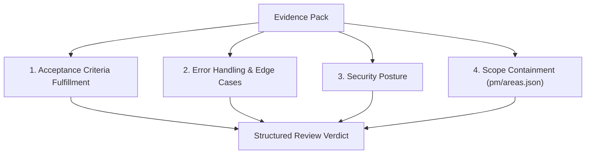

# Tier 1 Fresh-Context Reviewer Subagent Specification

**Version:** 1.0.0  
**Status:** Canonical  
**Applies to:** Antigravity AI Agents across Portfolio & Sibling Projects  
**Governing Standard:** [`pm/standards/AGENT_REVIEW_CONTRACT.md`](./AGENT_REVIEW_CONTRACT.md)  

---

## 1. Executive Summary & Architecture

The **Tier 1 Reviewer Subagent** is an isolated, read-only AI agent invoked in the inner development loop before code is committed to a pull request.

### The Problem It Solves
When a primary coding agent works on a feature, it accumulates long conversational context, error logs, and trial-and-error reasoning. This creates two distinct psychological failure modes in LLMs:
1. **Confirmation Bias / Self-Review Blindness:** The model reviews what it *intended* to do rather than what the code actually does.
2. **Context Pollution:** Residual error logs, hallucinations, and outdated intermediate state degrade reasoning depth.

### The Solution: Isolated Fresh Context
The Tier 1 Reviewer Subagent runs with **clean, isolated context**, receiving solely:
1. The Task Acceptance Criteria and Objective.
2. The Deterministic Verification Results (`npm run build` output).
3. The Clean Unified Git Diff.
4. The Matched Scope Boundaries from `pm/areas.json`.

```text
┌────────────────────────────────┐
│   Primary Coding Agent         │
│   (Accumulates 50k+ tokens)    │
└──────────────┬─────────────────┘
               │ 1. Completes coding
               │ 2. Runs npm run agent:review-pack <TASK_ID>
               ▼
┌────────────────────────────────┐
│      Evidence Pack (.md)       │  <── Isolated Boundary
└──────────────┬─────────────────┘
               │ 3. Fresh invocation with Evidence Pack
               ▼
┌────────────────────────────────┐
│   Tier 1 Reviewer Subagent     │
│   - Zero prior conversation   │
│   - Read-only tools            │
│   - Strict Schema Output       │
└──────────────┬─────────────────┘
               │ 4. Verdict: PASS or CHANGES_REQUESTED
               ▼
┌────────────────────────────────┐
│   Primary Coding Agent         │
│   - Fixes blockers (Max 2 iter)│
└────────────────────────────────┘
```

---

## 2. Tooling & Permission Boundaries (Least Privilege)

To ensure the review is objective and cannot accidentally tamper with working state, the reviewer subagent operates under strict read-only permissions:

| Permitted Capabilities | Prohibited Capabilities |
| :--- | :--- |
| `read_file` (inspecting source files, types, config) | `write_file` (modifying repository files) |
| `search_web` / `read_file` (querying documentation) | `edit_file` (altering repository files) |
| Read-only commands (`git diff`, `git log`, `cat`) | Mutating commands (`git commit`, `git push`, `npm install`) |
| Structured JSON Verdict Generation | Unstructured conversational debates |

> [!IMPORTANT]
> The reviewer subagent **never writes fixes directly**. It diagnoses defects and returns actionable remediation snippets to the primary agent.

---

## 3. Four Core Evaluation Axes

The reviewer subagent audits the branch diff against four mandatory axes:



### Axis 1: Acceptance Criteria Fulfillment
- Check every item in the task specification checklist.
- For each criterion, identify the exact lines in the diff that implement it.
- If a criterion is missing, stubbed with TODOs, or only partially implemented, record a **P0 Blocker**.

### Axis 2: Error Handling & Edge Cases
- **Null / Undefined Safety:** Are optional chained accesses safe? Does passing `undefined`, `null`, or an empty string cause unhandled exceptions?
- **Promise Rejections:** Are async operations wrapped in try-catch blocks or properly propagated?
- **Boundary Conditions:** Are empty arrays, zero counts, and max-length bounds handled cleanly?
- If an unhandled exception or crash condition is found, record a **P0 Blocker**.

### Axis 3: Security Posture
- **Secret Leaks:** Check that no private keys, PAT tokens, or API credentials are hardcoded.
- **Injection & Traversal:** Verify that user inputs or path strings are sanitized against path traversal (`../`) and shell injection.
- If a security risk is identified, record a **P0 Blocker**.

### Axis 4: Scope Containment & Architectural Boundaries
- Inspect the list of modified files against:
  1. The declared `target_paths` in task frontmatter.
  2. The registered domain paths in `pm/areas.json`.
- If changes modify files in an unrelated domain without justification, record a **P1 High defect**.

---

## 4. Loop Control & Termination Contract

The loop between Primary Agent and Reviewer Subagent is governed by strict termination limits:

```text
Iteration 1:
  Primary Agent finishes work.
  Primary runs: npm run agent:review-pack <TASK_ID>
  Primary invokes Tier 1 Reviewer Subagent.
  Reviewer returns ReviewVerdict JSON.

Decision Gate 1:
  IF verdict == "PASS" (blocking_count == 0):
    -> Success! Move task to 2-review.
    -> Open Pull Request with Evidence Pack.
  IF verdict == "CHANGES_REQUESTED":
    -> Primary Agent reads P0/P1 findings.
    -> Primary Agent edits code to address findings.
    -> Primary Agent runs npm run build (verifies fix).
    -> Primary Agent generates updated evidence pack.
    -> Primary Agent invokes Reviewer Subagent for Iteration 2.

Iteration 2:
  Reviewer evaluates updated diff against previous blockers.
  Reviewer returns updated ReviewVerdict JSON.

Decision Gate 2:
  IF verdict == "PASS":
    -> Success! Move task to 2-review.
  IF verdict == "CHANGES_REQUESTED":
    -> Loop ceiling reached.
    -> Set status to ESCALATED_TO_HUMAN.
    -> Primary Agent stops work and alerts human with findings summary.
```

---

## 5. Reviewer Subagent Response Specification

The reviewer subagent must format its response as pure JSON conforming to `pm/standards/schemas/review-verdict.schema.json`.

```json
{
  "task_id": "TASK-020",
  "verdict": "PASS",
  "iteration": 1,
  "evaluated_at": "2026-10-30T16:15:00Z",
  "reviewer": "agent:reviewer-subagent",
  "deterministic_checks": {
    "build": "SUCCESS"
  },
  "blocking_count": 0,
  "summary": "All 4 acceptance criteria validated. Scope is cleanly bounded within review/agentic. Zero blockers.",
  "findings": []
}
```

